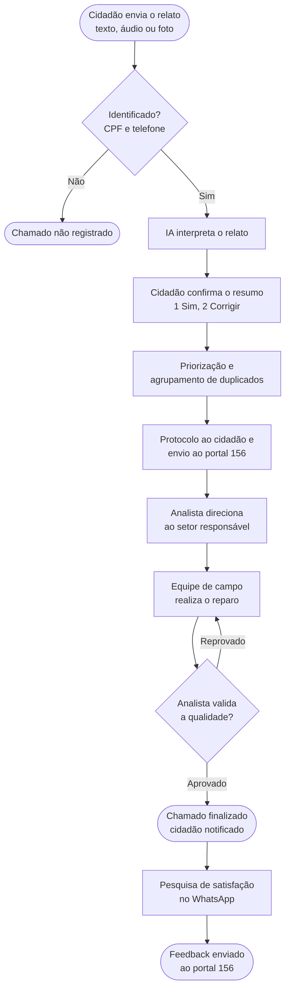
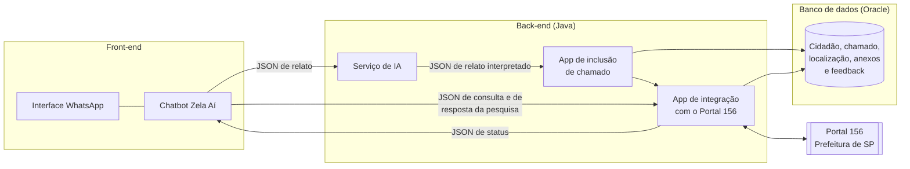
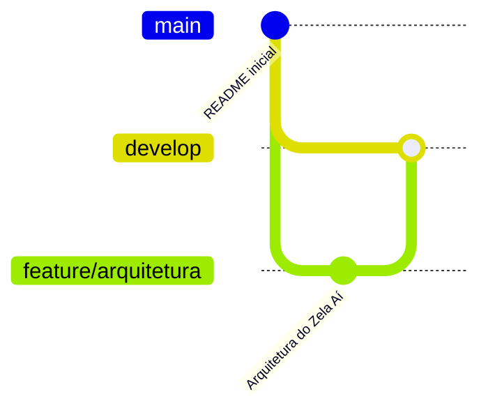

<div align="center">

# 🏙️ Zela Aí

### Zeladoria urbana pelo WhatsApp, com inteligência artificial, integrada ao portal 156 da Prefeitura de São Paulo

*Do problema na rua ao chamado no 156, em uma conversa de WhatsApp.*


</div>

---

## 📑 Índice

1. [Em uma frase](#-em-uma-frase)
2. [O problema](#-o-problema)
3. [O que o cidadão ganha](#-o-que-o-cidadão-ganha)
4. [Como funciona](#-como-funciona)
5. [Objetivos e ODS](#-objetivos-e-ods)
6. [Arquitetura](#-arquitetura)
7. [Segurança e LGPD](#-segurança-e-lgpd)
8. [Tecnologias](#️-tecnologias)
9. [Estrutura do repositório](#-estrutura-do-repositório)
10. [Fluxo de trabalho (Git Flow)](#-fluxo-de-trabalho-git-flow)

---

## 💡 Em uma frase

O cidadão relata um problema da rua (buraco, calçada quebrada, rampa danificada, iluminação apagada) pelo **WhatsApp**, por **texto, áudio ou foto**, **sem instalar aplicativo e sem cadastro prévio**. O chamado chega ao portal 156 já organizado e priorizado, e o cidadão acompanha tudo pela mesma conversa.

---

## 🚧 O problema

Os espaços de circulação pública deteriorados e sem padronização geram transtornos diários, aumentam o risco de acidentes e desencorajam o uso seguro e eficiente da cidade pela população. Isso pesa mais para quem tem mobilidade reduzida, para idosos e para pessoas com pouca familiaridade digital.

> [!IMPORTANT]
> Muitos canais de zeladoria dependem de aplicativo ou site. Quem não instala, não se cadastra ou não domina a tecnologia fica sem voz, e o problema da rua continua sem registro.

---

## ✨ O que o cidadão ganha

| | Para o cidadão | O que muda na prática |
|:-:|---|---|
| 📱 | **Sem barreira de entrada** | Basta o WhatsApp, que a pessoa já usa todos os dias. Nada para baixar e nenhum formulário longo. |
| 🎙️ | **Fala do jeito mais fácil** | Texto, áudio ou foto. Quem não consegue digitar pode falar; quem prefere mostrar pode mandar a foto. |
| 🕐 | **Qualquer hora, qualquer lugar** | O chamado pode ser aberto na hora, enquanto a pessoa está diante do problema. |
| 🤖 | **Sem precisar saber o que escrever** | A IA entende o relato, identifica categoria, endereço e gravidade, e pergunta só o que faltar. |
| ✅ | **Confirma antes de enviar** | O sistema devolve um resumo e o cidadão responde **1 (Sim)** ou **2 (Corrigir)**. Nada é registrado sem a confirmação dele. |
| 🧾 | **Protocolo na mesma hora** | O cidadão recebe o número do protocolo, com data e hora do registro. |
| 🔔 | **Acompanha sem perguntar** | A cada mudança de status no 156, chega uma mensagem no WhatsApp. Sem ligar, sem entrar em portal. |
| 🎛️ | **Controle do próprio chamado** | Pelo WhatsApp, ele consulta, complementa com nova foto ou informação e cancela o que abriu. |
| 🗺️ | **Vê o que acontece no bairro** | Consulta chamados de outras pessoas por cidade, bairro e rua. O CPF aparece mascarado, sem nome nem telefone. |
| ♿ | **Acessibilidade em primeiro lugar** | Problemas que afetam a mobilidade têm peso maior na priorização, e chamados repetidos sobre o mesmo problema são agrupados. |
| 💬 | **Voz sobre o serviço** | Depois do encerramento, o cidadão avalia o atendimento pelo próprio WhatsApp, e a avaliação chega à Prefeitura. |
| 🔒 | **Dados protegidos** | Aviso de privacidade na primeira conversa, coleta mínima e CPF nunca exposto em consultas públicas. |

---

## 🔄 Como funciona



**Menu do chatbot**

```text
1  Abrir chamado
2  Meus chamados
3  Consultar por local
0  Voltar
```

<details>
<summary><b>Ver o passo a passo detalhado</b></summary>

1. O cidadão envia uma mensagem ao Zela Aí no WhatsApp.
2. O sistema verifica o CPF e o telefone. Quem não se identifica não registra chamado. Na primeira vez, o CPF é vinculado ao número; depois disso, o número já vinculado dispensa informar o CPF de novo.
3. O cidadão descreve o problema por texto, áudio ou foto e informa o endereço ou compartilha a localização.
4. A IA transcreve o áudio, lê a foto e extrai categoria, endereço e gravidade. Se faltar algo, o chatbot pergunta.
5. O chatbot mostra um resumo e o cidadão confirma.
6. As regras de priorização, em tabelas auditáveis, calculam a prioridade e agrupam chamados duplicados. A IA sugere, mas não decide a prioridade.
7. O cidadão recebe o protocolo, e o chamado segue ao portal 156 com a origem "Zela Aí".
8. O analista de chamados verifica o setor responsável e direciona; a equipe de campo atende por ordem de prioridade.
9. O analista valida a qualidade do reparo. Se reprovado, o chamado volta à fila da equipe de campo.
10. Com o chamado finalizado, o cidadão é avisado pelo WhatsApp.
11. O cidadão recebe uma pesquisa de satisfação curta, com opções numeradas. A resposta é registrada e enviada ao portal 156, ligada ao protocolo.

</details>

---

## 🎯 Objetivos e ODS

| Código | Objetivo | Resultado esperado |
|:-:|---|---|
| **GOL-01** | Permitir que o cidadão registre e acompanhe problemas urbanos sem barreira de acesso | Cidadãos abrem e acompanham chamados pelo WhatsApp, sem instalar aplicativo nem se cadastrar |
| **GOL-02** | Permitir que o cidadão envie seu feedback sobre o serviço à Prefeitura de São Paulo | A maior parte das notas enviadas pelos cidadãos indica satisfação com o serviço prestado |

**Objetivos de Desenvolvimento Sustentável (ONU)**

| ODS | Contribuição |
|:-:|---|
| **10** Redução das desigualdades | Inclui quem tem menos acesso à tecnologia |
| **11** Cidades e comunidades sustentáveis | Ruas e calçadas mais seguras e acessíveis |
| **9** Indústria, inovação e infraestrutura | Inovação digital aplicada à gestão urbana |

---

## 🧩 Arquitetura

A arquitetura está documentada no **ArchiMate** (ferramenta Archi), em três visões, seguindo as fases do TOGAF:

| Visão | O que mostra |
|---|---|
| **Visão da arquitetura** | Cidadão (stakeholder), driver, assessment, objetivos, resultados esperados, requisitos e regras |
| **Arquitetura de negócio** | Atores, papéis, funções, processos, eventos de início e fim e fluxos de trabalho |
| **Arquitetura de sistema** | Front-end, back-end e banco de dados, com as interfaces entre as camadas |

### Arquitetura de sistema



| Camada | Componentes |
|---|---|
| **Front-end** | Interface WhatsApp e Chatbot Zela Aí (registro, consulta e feedback) |
| **Back-end** | Serviço de IA, App de inclusão de chamado (identificação, protocolo, priorização e duplicados) e App de integração com o Portal 156 |
| **Banco de dados** | Registros de cidadão, chamado, anexos, localização, feedback e consulta de chamados |

> [!NOTE]
> O portal 156 continua sendo o sistema do gestor. O Zela Aí se conecta a ele por integração e não exige nenhuma tela nova para a equipe da Prefeitura.

---

## 🔒 Segurança e LGPD

- 🛡️ Aviso de privacidade na primeira interação e aceite para o envio ativo de mensagens, como a pesquisa de satisfação.
- 🧮 Coleta mínima: só os dados necessários para atender o chamado.
- 🙈 CPF mascarado em qualquer consulta pública. Nome e telefone nunca são exibidos.
- 🔐 Tráfego criptografado (HTTPS/TLS).
- 📋 Regras de priorização em tabelas versionadas e auditáveis, com histórico de quem mudou o quê e quando.
- 🏛️ A Prefeitura de São Paulo é a controladora dos dados e define retenção e uso.

---

## 🛠️ Tecnologias

| Camada | Tecnologia |
|---|---|
| Canal | WhatsApp Business Platform (API em nuvem da Meta), por webhook e HTTPS |
| Back-end | Java |
| Banco de dados | Oracle |
| IA | Serviço de IA externo para transcrição de áudio, leitura de imagem e extração de campos |
| Integração | REST com JSON, idempotente pelo número de protocolo |

> [!TIP]
> **Escopo do MVP:** a integração com o portal 156 é simulada (API ou tabela espelho), para demonstrar o fluxo completo.

---

## 📁 Estrutura do repositório

```text
zela-ai/
├── README.md
├── Arquitetura/
│   └── ZELA_AI.archimate        # modelo de arquitetura (Visão, Negócio e Sistema)
└── Documento/
    └── Zela_Ai_Solucao.docx     # descrição completa da solução
```

---

## 🌿 Fluxo de trabalho (Git Flow)



| Branch | Função |
|---|---|
| `main` | Versão estável do projeto |
| `develop` | Integração do trabalho em andamento |
| `feature/arquitetura` | Documentação da arquitetura inicial, integrada à `develop` ao ser finalizada |

---

<div align="center">

**FIAP · Sistemas de Informação, 3º ano · Global Solution 2026.2 · Desafio CitizenTech**

</div>
